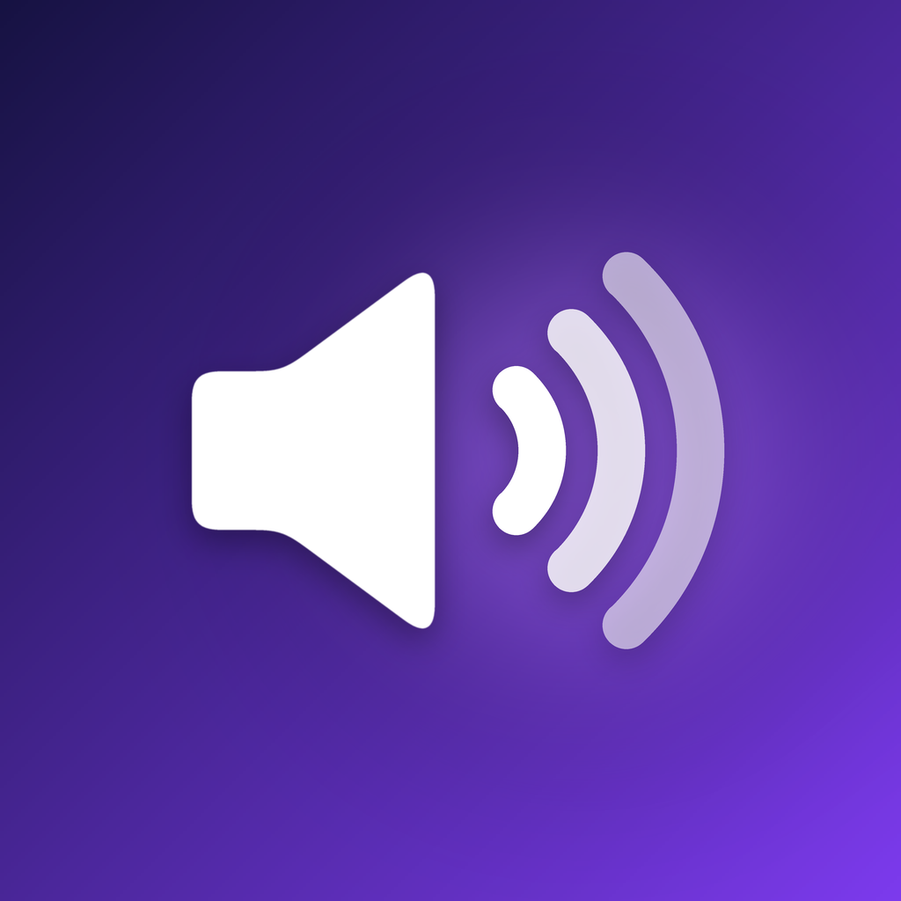

# Claude Sound Effects

A [Claude Code](https://claude.com/claude-code) plugin that plays a sound when Claude finishes a task or needs you. Start a long task, switch to another window, and come back when you hear it.

- Plays a sound that already ships with macOS, so there's nothing to download
- Runs in the background and never slows Claude down
- Lets you use your own sounds, change the volume, or mute it

## Contents

- [What it does](#what-it-does)
- [Requirements](#requirements)
- [Install](#install)
- [Customize](#customize)
- [How it works](#how-it-works)
- [Troubleshooting](#troubleshooting)
- [Uninstall](#uninstall)
- [Development](#development)
- [License](#license)

## What it does

The plugin plays the **Portal** alert tone, one of the alert tones built into macOS, at these moments:

| Moment | Claude Code hook | Event name (for custom sounds) |
|---|---|---|
| Claude finishes responding | `Stop` | `stop` |
| Claude needs you: a permission prompt, or it's been waiting a while for your reply | `Notification` | `notification` |
| You start a new session (not when you resume or run `/clear`) | `SessionStart` | `session-start` |
| The conversation is about to be compacted | `PreCompact` | `pre-compact` |

You can give each moment a different sound. See [Use your own sounds](#use-your-own-sounds).

## Requirements

- **macOS.** The plugin plays sounds with `afplay` and uses a sound that ships with macOS. On Linux and Windows it installs fine but makes no sound.
- **Claude Code** with plugin support.

## Install

Run these inside Claude Code:

```
/plugin marketplace add Aryavardhansharma/claude-sound-effects
/plugin install sound-effects@sound-effects-marketplace
```

Or run them from your terminal:

```sh
claude plugin marketplace add Aryavardhansharma/claude-sound-effects
claude plugin install sound-effects@sound-effects-marketplace
```

Then restart Claude Code. Plugins load when a session starts, so you'll hear the first sound when your next session opens.

### Try it without installing

```sh
git clone https://github.com/Aryavardhansharma/claude-sound-effects.git
claude --plugin-dir ./claude-sound-effects
```

This loads the plugin for that one session only.

## Customize

### Use your own sounds

Put a sound file in `~/.claude/sounds/` and name it after the event it should replace:

| File name | Plays when |
|---|---|
| `stop.<ext>` | Claude finishes responding |
| `notification.<ext>` | Claude needs you |
| `session-start.<ext>` | A new session starts |
| `pre-compact.<ext>` | The conversation is about to be compacted |

Supported formats: `.aiff`, `.wav`, `.mp3`, `.m4a`, `.caf`, `.m4r`.

For example, to use your own sound when Claude finishes:

```sh
mkdir -p ~/.claude/sounds
cp ~/Downloads/done.mp3 ~/.claude/sounds/stop.mp3
```

Any event without a custom file keeps the default Portal sound. Changes take effect on the next event, with no restart needed.

#### Use a different built-in macOS sound

macOS has more alert tones than the ones in System Settings. You can link to one instead of copying it. This example uses *Aurora* when Claude needs you:

```sh
mkdir -p ~/.claude/sounds
ln -s "/System/Library/PrivateFrameworks/ToneLibrary.framework/Versions/A/Resources/AlertTones/Modern/Aurora.m4r" \
      ~/.claude/sounds/notification.m4r
```

To find others, browse these folders. Run `afplay <file>` to hear one.

| Folder | Examples |
|---|---|
| `/System/Library/PrivateFrameworks/ToneLibrary.framework/Versions/A/Resources/AlertTones/Modern/` | Aurora, Bamboo, Complete, Hello, Input |
| `/System/Library/PrivateFrameworks/ToneLibrary.framework/Versions/A/Resources/AlertTones/EncoreInfinitum/` | Cheers, Droplet, Passage, Portal |
| `/System/Library/PrivateFrameworks/ToneLibrary.framework/Versions/A/Resources/AlertTones/Classic/` | Tri-Tone, Ding, Bell, Glass |
| `/System/Library/Sounds/` | Glass, Hero, Ping, Pop, Sosumi |

### Change the volume

Set `CLAUDE_SFX_VOLUME` to a number from `0` (silent) to `1` (full). The default is `1`. This volume is relative to your Mac's own volume.

Add it to your shell profile (`~/.zshrc` on most Macs):

```sh
export CLAUDE_SFX_VOLUME=0.5
```

Or set it in `~/.claude/settings.json` so it only applies to Claude Code:

```json
{
  "env": {
    "CLAUDE_SFX_VOLUME": "0.5"
  }
}
```

### Mute

| To | Run |
|---|---|
| Mute all sounds | `touch ~/.claude/sfx-muted` |
| Unmute | `rm ~/.claude/sfx-muted` |
| Mute for one session | `CLAUDE_SFX_MUTE=1 claude` |
| Turn the plugin off | `/plugin disable sound-effects` |

Muting with the file takes effect right away, with no restart needed.

## How it works

```
claude-sound-effects/
├── .claude-plugin/
│   ├── plugin.json        # Plugin name, version, description
│   ├── marketplace.json   # Lets the repo be added as a marketplace
│   └── icon.png           # Plugin icon (1024×1024)
├── assets/
│   └── make_icon.py       # Draws icon.png
├── hooks/
│   └── hooks.json         # Connects Claude Code events to the script
├── scripts/
│   └── play-sound.sh      # Picks a sound and plays it
├── CHANGELOG.md
├── LICENSE
└── README.md
```

1. **`hooks/hooks.json`** registers four [hooks](https://code.claude.com/docs/en/hooks): `Stop`, `Notification`, `SessionStart` (startup only) and `PreCompact`. Each one runs `play-sound.sh` with the event name, such as `play-sound.sh stop`.
2. **`scripts/play-sound.sh`** then:
   - reads the hook's input from Claude Code and ignores it
   - exits quietly if you've muted sounds
   - picks a sound: your file in `~/.claude/sounds/` first, then Portal, then `/System/Library/Sounds/Glass.aiff` if a future macOS moves Portal
   - starts `afplay` in the background and exits right away, so Claude never waits for the sound to finish

The script always exits successfully. A missing sound or a missing `afplay` means no sound, never an error in Claude Code.

## Troubleshooting

**I don't hear anything.**

1. Restart Claude Code. Plugins and hooks load when a session starts.
2. Run `/plugin` and check that `sound-effects` is installed and enabled.
3. Check that you haven't muted it: `ls ~/.claude/sfx-muted` should say *No such file*.
4. Check that your Mac can play the sound:
   ```sh
   afplay "/System/Library/PrivateFrameworks/ToneLibrary.framework/Versions/A/Resources/AlertTones/EncoreInfinitum/Portal-EncoreInfinitum.caf"
   ```
5. Start Claude Code with `claude --debug` to see each hook as it runs.

**My custom sound doesn't play.** Check the file name. It must be the event name plus a supported extension, such as `stop.mp3` (not `Stop.mp3` or `stop.ogg`). Then check that `afplay ~/.claude/sounds/stop.mp3` plays it.

**I hear the sound when I resume a session.** It shouldn't happen. The start sound only plays for new sessions. If you hear it on resume, please [open an issue](https://github.com/Aryavardhansharma/claude-sound-effects/issues).

**The "needs you" sound plays when I didn't do anything.** Claude Code also sends a notification when it has been waiting for your reply for a while. That's expected.

## Uninstall

```
/plugin uninstall sound-effects@sound-effects-marketplace
/plugin marketplace remove sound-effects-marketplace
```

You can also delete your custom sounds and mute file if you made any:

```sh
rm -rf ~/.claude/sounds ~/.claude/sfx-muted
```

## Development

```sh
git clone https://github.com/Aryavardhansharma/claude-sound-effects.git
cd claude-sound-effects

# Run Claude Code with your local copy of the plugin
claude --plugin-dir .

# Play a sound without starting Claude
echo '{}' | ./scripts/play-sound.sh stop

# Check the plugin and marketplace manifests
claude plugin validate --strict .

# Redraw the icon after editing assets/make_icon.py (needs Pillow)
python3 assets/make_icon.py .claude-plugin/icon.png
```

When you release a change, bump `version` in `.claude-plugin/plugin.json` and add an entry to `CHANGELOG.md`. People who installed the plugin can get the new version by running:

```sh
claude plugin marketplace update sound-effects-marketplace
claude plugin update sound-effects@sound-effects-marketplace
```

## License

[MIT](LICENSE)
